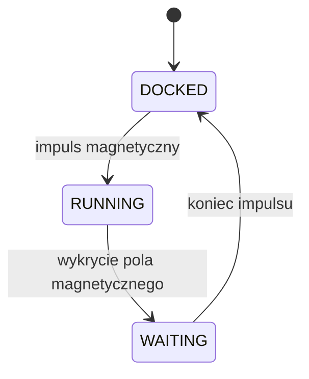

# Robot mobilny – line follower ze skrętem 4 kół (swerve)

Robot magazynowy jeżdżący po linii w obu kierunkach, z niezależnym skrętem i napędem każdego z czterech kół. Położenie linii mierzy 12 czujników odbiciowych IR, a sterowanie opiera się na regulatorze PID. Robot zatrzymuje się i rusza między symetrycznymi stacjami dokującymi, wykrywając je czujnikami Halla.

<!-- TODO: zdjęcie lub GIF robota -->
<!--  -->

## Spis treści
- [Sprzęt](#sprzęt)
- [Zasilanie](#zasilanie)
- [Sterowanie](#sterowanie)
- [Obsługa dwóch kierunków](#obsługa-dwóch-kierunków)
- [Maszyna stanów](#maszyna-stanów)
- [Scenariusz działania](#scenariusz-działania)
- [Struktura projektu](#struktura-projektu)
- [Budowanie i wgrywanie](#budowanie-i-wgrywanie)

## Sprzęt

| Element | Ilość | Zastosowanie |
|---|---|---|
| ESP32 | 1 | mikrokontroler |
| Pololu QTR RC (czujniki odbiciowe IR) | 12 (6 z przodu, 6 z tyłu) | wykrywanie linii |
| Multiplekser 6-kanałowy | 1 | przełączanie między zestawem przednim i tylnym czujników QTR |
| Czujnik Halla | 2 (1 z przodu, 1 z tyłu) | wykrywanie impulsów magnetycznych ze stacji dokujących |
| Serwo XYZrobot | 8 | 4 sterują kątem skrętu kół, 4 prędkością obrotową |

Każde z czterech kół ma własną parę serw: jedno ustawia kąt skrętu, drugie napęd. Dzięki temu skręcają wszystkie koła.

## Zasilanie

- pakiet **6S** jako źródło główne,
- przetwornica na **12 V** dla serw,
- przetwornica na **5 V** dla ESP32.

## Sterowanie

Położenie linii wyznacza biblioteka producenta czujników (Pololu QTRSensors), a na jego podstawie regulator **PID** wylicza sterowanie. Kąt skrętu kół jest ograniczony do **±45°**, a prędkość maleje w trakcie skręcania.

Czujniki są kalibrowane po włączeniu zasilania, w funkcji `setup()`.

## Obsługa dwóch kierunków

Robot jeździ w obie strony, więc kod odróżnia stronę, z której robot aktualnie „patrzy”. Opisuje to struktura **`Side`**. Obecna strona (`current side`) jest ustawiana w stanie `DOCKED`, na podstawie tego, z której strony wykryto impuls magnetyczny.

Struktura `Side` zawiera m.in.:

| Pole | Opis |
|---|---|
| pin czujnika Halla | czujnik po danej stronie robota |
| sygnał do multipleksera | wybiera zestaw czujników QTR tej strony |
| lista kierunków silników | ustala kierunek obrotu napędów dla jazdy w tę stronę |
| TODO | pozostałe pola |

<!-- TODO: wklej definicję struct Side i uzupełnij tabelę dokładnymi nazwami pól -->

Po zmianie strony multiplekser przełącza odczyt na właściwy zestaw czujników, a kierunki napędów się odwracają, dzięki czemu ta sama logika PID działa w obu kierunkach.

## Maszyna stanów

Robot ma trzy stany. Przejścia wyzwalają impulsy pola magnetycznego ze stacji dokujących.



| Stan | Zachowanie |
|---|---|
| `DOCKED` | Robot jest zadokowany. Prostuje koła i czeka na impuls magnetyczny, który przełącza go w `RUNNING`. Na podstawie czujnika Halla, który wykrył impuls, ustawia `current side`. |
| `RUNNING` | Aktualizuje sterowanie na podstawie wyjścia PID. Skręca koła w zakresie ±45° i zwalnia w trakcie skręcania. Po wykryciu pola magnetycznego przechodzi w `WAITING`. |
| `WAITING` | Stan przejściowy między `RUNNING` a `DOCKED`. Zatrzymuje wszystkie silniki, a po zakończeniu impulsu pola magnetycznego przechodzi w `DOCKED`. |

## Scenariusz działania

1. Po włączeniu zasilania robot kalibruje czujniki QTR (`setup()`) i przechodzi w stan `DOCKED`.
2. Impuls magnetyczny wypuszcza go ze stacji (`RUNNING`), a robot jedzie po linii do drugiej stacji.
3. W stacji docelowej magnes, aktywowany krańcówką, powoduje przejście w `WAITING`, a po zakończeniu impulsu w `DOCKED`.
4. Robot czeka na kolejny impuls. Ponieważ stacje są symetryczne, cykl może powtarzać się w nieskończoność, a robot na zmianę jeździ w obu kierunkach.

## Struktura projektu

```
robot_mobilny/
├── src/            # kod źródłowy
├── include/        # nagłówki
├── lib/            # biblioteki lokalne
└── platformio.ini  # konfiguracja PlatformIO
```
<!-- TODO: dopasuj do prawdziwej struktury repo -->

## Budowanie i wgrywanie

Projekt jest zbudowany w [PlatformIO](https://platformio.org/).

```bash
git clone https://github.com/Antoni-pcb/robot_mobilny.git
cd robot_mobilny
pio run              # kompilacja
pio run -t upload    # wgranie na ESP32
pio device monitor   # podgląd portu szeregowego
```

## Autor

Antoni – [@Antoni-pcb](https://github.com/Antoni-pcb)